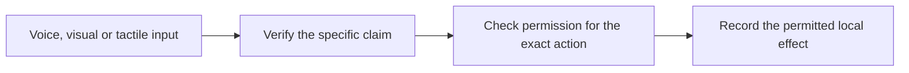

# OpenModalityTrust

**Trust for AI agents that interact through voice, sight, and touch.**

An AI assistant can hear a request, read a display, or observe a button press.
Before it acts, it needs to establish who supplied that information, what the
information actually proves, and what the user authorized it to do.

OpenModalityTrust is an experimental open-source project for making those checks
explicit and enforceable. It brings together modality-specific evidence and a
shared permission gate, with decisions checked in code outside the language model.

[Documentation map](docs/README.md) · [Glossary](docs/glossary.md) ·
[Code map](docs/code-map.md) · [Agent guide](AGENTS.md)

## The problem: a convincing interaction can lead to the wrong action

Imagine asking an assistant to collect order 42. It calls the store, reads a
pickup kiosk, and encounters a release button. Along the way, it needs to answer
several different questions:

| What the assistant encounters | What it needs to establish |
| --- | --- |
| A caller says, “The customer approved this.” | Which customer authorized which action, and can the business verify that permission? |
| A kiosk displays “Order ready” beside a QR code. | Who signed the claim, which order does it concern, and does it belong to this interaction? |
| A controller reports that a button was pressed. | What contact was reported, and does the action separately require the customer's approval? |
| A request is retried after a connection failure. | Has it already been used, or has its permission expired or been revoked? |

Permission to collect an order has a specific scope. Changing its delivery
address, acting on a different order, or treating contact as customer consent
requires its own justification. A valid signature establishes only the claims
and guarantees that the signing process can support.

This pickup scenario motivates the research. Today's shared demos exercise these
boundaries with generated inputs and local receipts; they do not release real orders.

## The idea: carry evidence all the way to the permission check

OpenModalityTrust separates an observation, a verifiable claim, and permission
for an exact action.



A receipt is a database record of an accepted request. The current visual and
tactile prototypes follow four rules:

1. **Bind evidence to the request.** A fresh challenge identifies the interaction
   and the exact principal, action, resource, purpose, and arguments.
2. **Check what the evidence supports.** A signed display statement authenticates
   that statement. A signed controller report identifies the reporting key under
   its configured capture assumptions. Neither authenticates everything around it.
3. **Require separate permission.** An owner grant specifies the exact action the
   agent may perform. An observation key cannot issue that permission.
4. **Enforce current state when committing.** The shared gateway checks expiry,
   revocation, and one-use state together with insertion of a local receipt.

The model can propose an action. Configured verification and authorization code
determines whether the available evidence and permission are sufficient.

## Why voice, sight, and touch belong in one project

A task may move from a phone call to a display to a physical interaction. The
meaning of its evidence needs to survive each transition: a fresh response does
not establish location, and a contact report does not establish consent.

The umbrella provides a place to define those boundaries consistently, share
verification machinery, and compare failures across interfaces. Each modality
keeps its own implementation and failure model. OpenAST and OpenATT currently
use the shared core; OpenAVT remains an independent voice implementation.

The longer-term research goal is **useful autonomy with explicit limits**:
maintain the evidence an action needs, obtain additional support when context
changes, and refuse conclusions the evidence cannot justify. General cross-modal
composition and selective evidence acquisition remain proposed work.

For agent builders, this offers an inspectable boundary between perception and
tool execution. For participating businesses and device operators, it makes the
requested action and delegated permission explicit. For researchers, it supplies
runnable implementations, attack cases, strong controls, and reproducible evidence.

## What works today

| Component | Implemented capability | Current evaluation |
| --- | --- | --- |
| [Shared core](core/README.md) | Exact-action binding, modality-specific issuer keys, separate one-use grants, durable revocation and replay state, transactional local receipts | Shared conformance and concurrency tests |
| [OpenAVT](https://github.com/ketanbj/openavt) | Protected structured requests carried through voice audio, with delegated permission checks | Experimental local voice implementation |
| [OpenAST](modalities/openast/README.md) | Signed visual statements encoded and decoded through actual QR images | 280 generated-image trials and 600 scripted policy checks |
| [OpenATT](modalities/openatt/README.md) | Signed controller reports, bounded force-trace processing, and contact-pattern checks | 240 generated-force trials and 640 scripted policy checks |

Both new gateways made the same decisions as a reference policy checker applying
the same rules. Their reports include channel failures and short-pattern collisions.
These results demonstrate local feasibility and help identify limitations. They
do not establish stronger protection than the reference checker. See the
[evidence index](research/README.md) for methods, raw reports, and paper drafts.

**Scope:** the shared atomic effect is a local SQLite receipt. Remote operations
and physical actuators need their own participating enforcement boundary. Camera
and force-sensor hardware studies, LLM evaluations, cloud deployment, and general
composition proofs remain future work. Physical proximity and human consent
cannot be inferred from the implemented signatures or contact patterns.

## Try the local prototypes

Requires Python 3.11+. The demos use generated inputs and ephemeral keys; no API
key, cloud account, or hardware is required. Clone the workspace:

```sh
git clone --recurse-submodules https://github.com/ketanbj/open-modality-trust.git
cd open-modality-trust
python3 -m venv .venv
source .venv/bin/activate
make install
make demo
```

The visual demo decodes a signed QR response, commits one permitted receipt,
and rejects replay. The tactile demo reads a generated force trace, rejects a
requirement for human consent, and commits a receipt under its supported contract.

Check the workspace and run the tests:

```sh
make help
make check
```

Run these commands from the umbrella root. The [development guide](docs/development.md)
has direct Python alternatives, checkout layouts and the child-before-parent
publishing workflow. Install these research packages from the checkout; no PyPI
publication is asserted.
The [core guide](core/README.md) and [local signing profile](spec/local-profile.md)
explain the implemented protocol. The shared JSON Schemas remain draft research
contracts; schema validation alone does not authenticate evidence.

## Explore and contribute

Start with the [architecture](docs/architecture.md),
[threat model](docs/threat-model.md), [research roadmap](docs/roadmap.md), and
[adapter contract](spec/adapter-contract.md). The research builds on established
cryptography, authentication, authorization, and information-flow control. Claims
of new composition rules or acquisition benefits must be demonstrated against
comparably expressive controls.

```text
docs/           architecture, threat model, assumptions and roadmap
spec/           draft contracts and the implemented local profile
core/           shared verifier and local receipt gate
conformance/    executable local conformance scope
benchmarks/     measured evidence index and future evaluation scope
integrations/   cloud and participating-backend integration plans
examples/       runnable modality examples and proposed handoffs
research/       evidence index and research direction
modalities/     pinned OpenAVT, OpenAST and OpenATT Git submodules
```

The modality repositories retain independent histories and release cycles. Their
submodule commits are pinned for reproduction. See the
[development workflow](docs/development.md) and [contribution guide](CONTRIBUTING.md).
